# USVBench

> **Status**: Active development (private). Open-source release targeted for 2026.

USVBench is a reinforcement-learning benchmark for unmanned surface vehicles (USVs), built on
[Isaac Lab](https://github.com/isaac-sim/IsaacLab): **11 task modules, 22 gym ids, 4 vessels** (Doc Ricketts
ROV, 5.5 m monohull, twin-hull BlueBoat, catamaran) in calm water, cross current and waves.

<p align="center">
  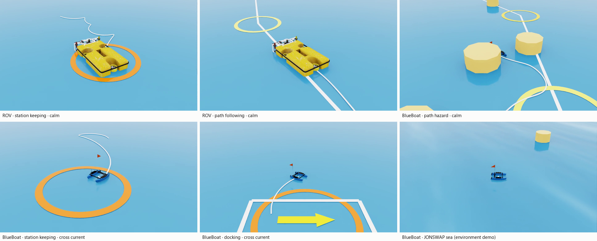
</p>
<p align="center"><sub>Isaac Sim recordings of the shipped checkpoints (deterministic, seed 42). Bottom right: JONSWAP sea, zero action.</sub></p>

## Visual overview

<table>
<tr>
<td align="center" width="33%">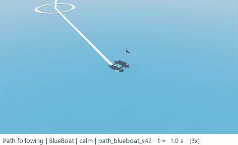<br><sub><b>Calm water</b> · BlueBoat path following</sub></td>
<td align="center" width="33%">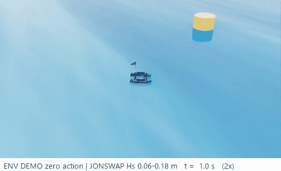<br><sub><b>JONSWAP</b> · Hs 0.06–0.18 m, Tp 2–4 s</sub></td>
<td align="center" width="33%">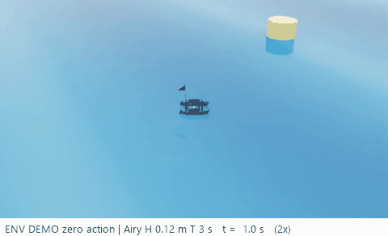<br><sub><b>Airy</b> · H 0.12 m, T 3 s</sub></td>
</tr>
</table>

Wave clips are zero-action environment demos (shade = surface elevation); no wave-trained baseline yet.

## Task demos

| | | |
|:---:|:---:|:---:|
| 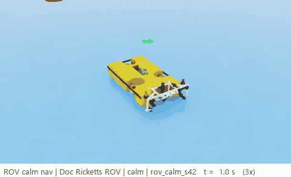<br>**Calm navigation** · ROV | 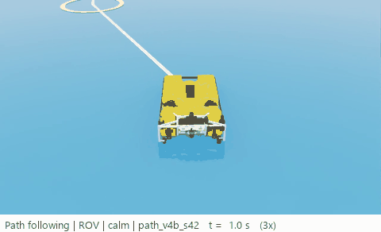<br>**Path following** · ROV | 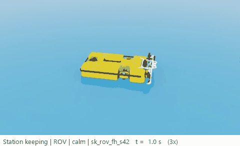<br>**Station keeping** · ROV |
| <br>**Path following** · BlueBoat | 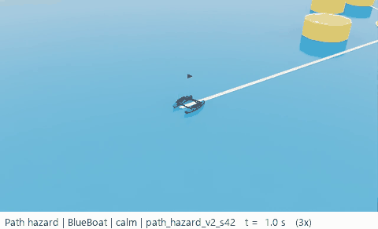<br>**Path hazard** · BlueBoat | 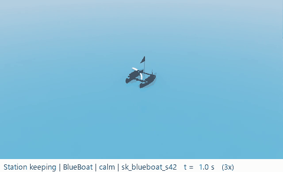<br>**Station keeping** · BlueBoat |
| 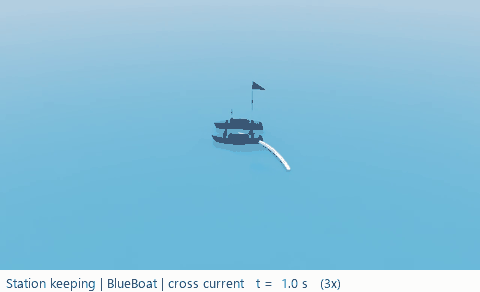<br>**Station keeping** · BlueBoat · current | 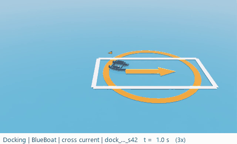<br>**Docking** · BlueBoat · current | 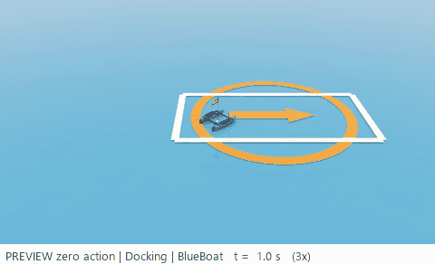<br>**Docking** · BlueBoat · *preview* |
| 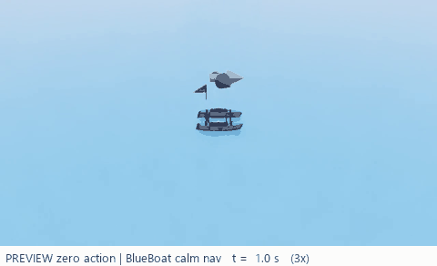<br>**Calm navigation** · BlueBoat · *preview* | 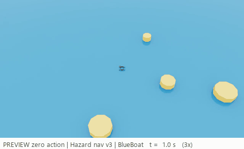<br>**Hazard navigation** · BlueBoat · *preview* | 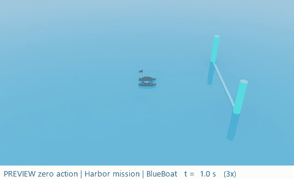<br>**Harbor mission** · BlueBoat · *preview* |

Deterministic policy, seed 42, first 30 s at 3x; *preview* = zero action (no reference policy yet). Monohull and
catamaran clips are omitted because no coloured source model could be traced. Rendering is display-only
(follow camera, official BB120 BlueBoat model, wake trail; [tools](results/retrain_2026-10/tools/)).

## Training curves

<p align="center">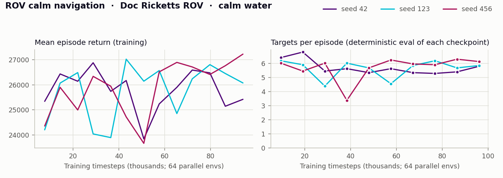</p>
<p align="center">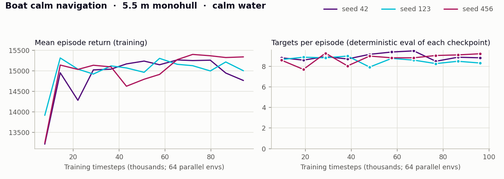</p>
<p align="center">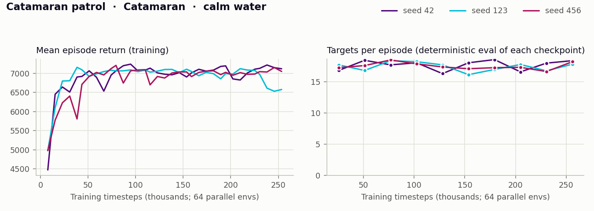</p>

One line per training seed. Left: training return. Right: deterministic evaluation of every saved checkpoint
(64 envs, 2000 steps). Logs in
[`results/retrain_2026-10/training_logs/`](results/retrain_2026-10/training_logs/).

## Tasks and baselines

| Task · vessel · condition | Gym id | Obs / Act | Metric | Result | Zero action | Checkpoint |
|---|---|---|---|---|---|---|
| Calm navigation · ROV | `Isaac-My-First-Task-Calm-Direct-v1` | 3 / 2 | targets / ep | **6.15 ± 0.09** (3 seeds) | – | `rov_calm_s42.pt` |
| Calm navigation · monohull | `Isaac-USVBench-Boat-Calm-Direct-v1` | 9 / 2 | targets / ep | **8.63 ± 0.12** (3 seeds) | – | `boat_calm_v26_s42.pt` |
| Patrol · catamaran | `Isaac-Catamaran-Patrol-Direct-v1` | 12 / 2 | targets / ep | **19.72 ± 0.40** (3 seeds) | – | `catamaran_p1_s42_fixed_256k.pt` |
| Path following · ROV | `Isaac-USV-PathFollow-Direct-v1` | 7 / 2 | success | 0.820 (seed 42) | 0.000 | `path_v4b_s42.pt` |
| Path following · BlueBoat | `Isaac-USV-PathFollow-BlueBoat-Direct-v1` | 7 / 2 | success | 1.000 (seed 42) | 0.000 | `path_blueboat_s42.pt` |
| Path hazard · BlueBoat | `Isaac-USV-PathHazard-Direct-v1` | 43 / 2 | success | 0.125 (seed 42) | 0.000 | `path_hazard_v2_s42.pt` |
| Station keeping · ROV | `Isaac-USV-StationKeep-Direct-v1` | 3 / 2 | success | 1.000 (seed 42) | 0.000 | `sk_rov_fh_s42.pt` |
| Station keeping · BlueBoat | `Isaac-USV-StationKeep-BlueBoat-Direct-v1` | 3 / 2 | success | 0.977 (seed 42) | 0.000 | `sk_blueboat_s42.pt` |
| Station keeping · BlueBoat · current | `Isaac-USV-StationKeep-BlueBoat-Current-Direct-v1` | 3 / 2 | success | 1.000 (seed 42) | 0.000 | `sk_blueboat_current_s42.pt` |
| Station keeping · monohull | `Isaac-USV-StationKeep-Boat-Direct-v1` | 3 / 2 | success | 1.000 (seed 42) | 0.000 | `sk_boat_s42.pt` |
| Docking · BlueBoat · current | `Isaac-USV-Dock-BlueBoat-Current-Direct-v1` | 6 / 2 | success @ 25 m | 0.125 (seed 42) | 0.008 | `dock_blueboat_current_s42.pt` |

- **Pending** (no reference policy yet): BlueBoat calm navigation (known issue), hazard navigation v3 and its
  Airy / JONSWAP variants, docking (monohull, BlueBoat calm), ordered harbor mission.
  **Planned**: wave navigation, wave obstacle avoidance, coverage variants, Gazebo sim-to-sim.
  No sim-to-real result is claimed.
- Measured 2026-10-15 ([raw values](results/retrain_2026-10/reference_evals.csv)); comparable within a task only.
  `rov_calm`, `boat_calm_v26`, `sk_boat` and `dock_blueboat_current` were retrained on 2026-10-15; the catamaran
  retrain is byte-identical to the shipped file.

## Quick start

1. Install [Isaac Lab](https://isaac-sim.github.io/IsaacLab/), then copy the task folder and `tasks/_shared/` into
   `IsaacLab/source/isaaclab_tasks/isaaclab_tasks/direct/`.
2. Set `USVBENCH_ASSETS` to `assets/` (catamaran patrol: `tasks/catamaran_patrol/assets/`).
3. Train, then evaluate (see each task's `STARTER_TASK.md` for its environment variables):

```bash
OBS_DIM=3 python scripts/train_with_eval.py --task=Isaac-My-First-Task-Calm-Direct-v1 \
  --num_envs=64 --headless --max_iterations=3000 --seed=42
python scripts/eval_benchmark.py --task=Isaac-My-First-Task-Calm-Direct-v1 --checkpoint=<path>.pt \
  --num_envs=64 --eval_steps=6000 --seed=2026 --headless
```

## Evaluation protocol

Deterministic policy (mean action); report mean ± std over training seeds 42 / 123 / 456, or label a single seed.

| Tasks | Script | Settings |
|---|---|---|
| Calm navigation, patrol | [`eval_benchmark.py`](scripts/eval_benchmark.py) | 64 envs, 6000 steps, seed 2026 |
| Path, docking, station keeping, harbor | [`eval_mission.py`](scripts/eval_mission.py) | 128 episodes, seed 42; docking `--spawn-distance 25` |
| Hazard navigation | [`eval_hazard_nav.py`](scripts/eval_hazard_nav.py) | 64 episodes, seed 42, level 1 |

## More

- [Task roadmap and measured baselines](TASKS.md) ·
  [Wave tasks](tasks/hazard_nav/WAVES.md) · [Wave parameters](docs/WAVE_PARAMETER_ALIGNMENT.md) ·
  [BlueBoat asset fix (2026-10-13)](docs/BLUEBOAT_ASSET.md) ·
  [Collaboration guide](docs/GITHUB_COLLABORATION.md)
- **License**: TBD (MIT or Apache-2.0 on public release). **Citation**: TBD (ICRA Datasets & Benchmarks 2026, in preparation).
