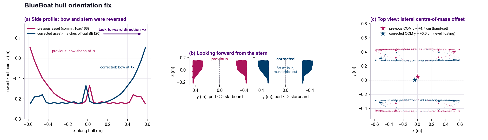

# BlueBoat asset: hull orientation fix

`assets/blueboat_physics.usd` and `assets/blueboat_visual.usd` were replaced on 2026-10-13.
The previous physics asset (commit `1cac168`, "BlueBoat USD from official CAD") had three defects
that came from the CAD-to-USD conversion, not from the official Blue Robotics files:

| | Previous asset | Corrected asset |
|---|---|---|
| Bow / stern | bow shape at **-x**, deepest stern point at +x; tasks drive along +x, so the boat ran stern-first | bow at +x |
| Port / starboard | the two hulls swapped: flat walls outboard, rounded sides inboard; `Hull01_Starboard` sat on the port side | flat walls inboard, rounded sides outboard, as on the real boat and the official BB120 model |
| Centre of mass | (0.006, **0.047**, 0.0068) m, hand-set | (-0.0358, 0.0026, 0.0068) m, above the CAD centre of buoyancy (level floating) |

Mass (17.26 kg), diagonal inertia (1.789, 1.094, 2.376) kg m^2, hull length (1.195 m) and hull spacing
(0.7214 m) are unchanged. The collision meshes keep their topology; only their placement changed.



## Why it went unnoticed

A bounding box is symmetric and cannot tell bow from stern, and the task plants never read the hull mesh:
every BlueBoat task samples the surface at six symmetric stations whose radii are solved from the
calibrated restoring stiffnesses (`VehicleSpec.surface_sample_offsets`), and applies the hydrodynamic
wrench through `set_external_force_and_torque` without an application point, i.e. at the centre of mass.
The reversed hulls therefore produced no force.

## What changes for users

- **Hydrodynamics: unchanged.** Buoyancy stations, damping, restoring stiffness and thrust do not depend
  on the mesh or on the centre-of-mass position.
- **Collisions with obstacles** now use the correctly oriented hull shapes (bow and stern profiles differ).
- **Centre of mass**: the rigid body now rotates about a point 3.6 cm aft of the asset origin instead of
  4.7 cm to port, so reported root positions move by a few centimetres during turns.
- **Rendering**: videos and screenshots now show the boat bow-first. The README preview images were
  rendered with the previous asset.

Results trained or evaluated with the previous asset stay valid as results of that asset. To reproduce
them exactly, restore it from history:

```bash
git checkout 1cac168 -- assets/blueboat_physics.usd
git checkout a9362d3 -- assets/blueboat_visual.usd
```

## Checks

```bash
python scripts/check_blueboat_orientation.py   # bow on +x, flat walls inboard, no lateral COM offset
python scripts/validate_blueboat_visual.py      # visual layer composes the physics asset unchanged
```

`check_blueboat_orientation.py` passes on the corrected asset and fails all six checks on the previous one.

## Official render model

`assets/BB120_official_visual_only.usd` (38.6 MB) is the official Blue Robotics BB120 model, converted for
rendering only: no collision, mass or physics schemas. HazardNav overlays it on the physics body when
`use_official_blueboat_visual=True`; the gray physics mesh stays authoritative for mass, inertia, collision,
buoyancy and drag. With the configured placement it matches the corrected hulls (bow on +x, same keel
heights at both ends, length within 1 cm). Its only external dependency is the `gltf/pbr.mdl` material
that ships with Isaac Sim.

## Still open

- The centre-of-mass height and the inertia are still hand-set, not measured.
- The two hull source meshes differ in volume by 2.4% (8.53 L vs 8.73 L); not yet explained.
- The corrected geometry was rebuilt and checked on 2026-09-18 against the official BB120 model
  (cross-sections at three stations, bow/stern features, antenna mast side).
